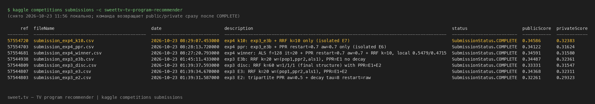

# Отчёт: рекомендации TV-программ (sweet.tv — TV program recommender, MAP@5)

**Квиз GSB, дедлайн 24.10.2026 19:00 МСК.** Индивидуальная работа.
Репозиторий: см. §9. Все числа в отчёте воспроизводимы командами из §9 и
происходят из таблиц `results/tables/` или из возвращённых Kaggle-скоров
(run-id указан).

---

## §1 Постановка

Конкурс [sweet.tv — TV program recommender](https://www.kaggle.com/competitions/sweettv-tv-program-recommender)
(slug `sweettv-tv-program-recommender`, id 24201) — community prediction,
лёд заморожен, поздние сабмиты принимаются. Метрика страницы — MAP@{K};
шаблон несёт пять id на строку, поэтому **везде K = 5**: в сабмите, в
валидации, в отчёте. Позиция в когорте (§10 квиза) определяется только
**возвращённым public score** назначенного сабмита.

Задача: по логу просмотров недель 11–30 предсказать, какие пять программ
каждый из 1 260 тестовых пользователей посмотрит в неделях 31–42.
Джойн лога к расписанию → валидация на хронологическом hold-out →
минимум два реализованных метода → гибрид с документированным выбором весов.

## §2 Данные (EDA: `docs/facts.md`, скрипт `artifacts/scripts/eda.py`)

| Файл | Строк | Роль |
|---|---:|---|
| `dataset11-30.csv` | 5 821 987 | лог просмотров (нед. 11–30) |
| `export_arh_11-20-final.csv` | 1 074 235 | расписание train |
| `export_arh_21-30-final.csv` | 1 074 394 | расписание validation |
| `export_arh_31-42-final.csv` | 1 295 378 | расписание test (31–42) |
| `submission.csv` | 1 260 × 5 | шаблон |

Ключевые факты (`docs/facts.md`):

- **Только 10,8 % строк расписания несут `tv_show_id`** (нед. 11–20:
  115 613 из 1 074 235; 21–30: 121 505 из 1 074 394; 31–42: 144 774 из
  1 295 378). Остальное — неразмеченный эфир, item'ом быть не может.
- Размеченные программы: 5 847 (11–20) / 6 363 (21–30) / 6 636 (31–42);
  пересечение всех трёх файлов — 3 260; **новых программ в тесте,
  отсутствующих в train, — 1 437** (`docs/facts.md:48-52`).
- Лог: 4 914 пользователей, `duraton` (опечатка в файле) == `stop_time −
  start_time` (проверка: 583/583 сэмплов, `docs/facts.md:65`), медиана 394 с.
- Тестовых пользователей: 1 260; **cold-start без истории — 0** (0,0 %,
  `docs/facts.md:83`).
- Среда: Python 3.14.8, macOS arm64, `uv`, SEED=42 везде.

## §3 Джойн лог × расписание (правило просмотра)

`artifacts/scripts/join_interactions.py`, проверки — `reports/join_checks.txt`:

1. **Канал:** `vsetv_id` ≡ `channel_id`. Сверено на сдвигах часовых поясов —
   максимум совпадений ровно на сдвиге 0 ч (иначе расписание ушло бы в UTC).
   98,0 % строк лога попадают в каналы расписаний (`docs/facts.md:60`).
2. **Пересечение интервалов** `[view_start, view_stop)` × `[air_start,
   air_start+duration)`.
3. **Порог «просмотрено»:** пересечение ≥ **300 с ИЛИ ≥ 50 % длительности
   программы**. Выбор в пользу гибридного правила: распределение
   `overlap/duration` у медианной программы даёт p50 = 8 % (`docs/facts.md:78`) —
   чистый процентный порог отсекает большинство реальных просмотров коротких
   программ; чистые секунды несправедливы к программам длиннее 10 минут.
   Оба компонента оставляют погрешность в обе стороны, поэтому «ИЛИ».
4. **`tv_show_id = 0`** — неразмеченный эфир: **исключён из джойна**
   (не item; стать item'ом не может). Как контекст просмотра не
   используется ни одним методом — единообразно.
5. Кандидат-неоднозначность (просмотр накрыл >1 эфира) разрешается выбором
   эфира с максимальным пересечением.

Дальше везде `user_interactions.parquet` (поля `user_id` (строка!), `tv_show_id`,
`week`, `overlap_seconds`).

## §4 Реализованные методы

Реализовано **шесть** (квиз требует ≥ 2 + popularity baseline):

| # | Метод | Скрипт | Суть |
|---|---|---|---|
| 0 | Popularity (baseline) | `final_models.py`, `strict_validation.py` | Recent-4w уникальные зрители; и pop×log(1+эфиров) |
| 1 | CBF | `exp_cbf_hw2.py` | косинус: категория/жанры/десятилетие + профиль пользователя из log1p(сек) |
| 2 | Association rules | `exp_assoc_rules.py` | транзакции-недели, support ≥ 0,2 %, lift > 1; скор = Σ confidence(A→c) |
| 3 | ALS (implicit MF) | `exp_rrf_hybrid.py` | лог-длительности, f=64, reg=0.05, 20 итер., SEED=42 |
| 4 | PPR | `exp_ppr.py`, `exp3_e1_attr_ppr.py` | бипартитный user–item (alpha=0.85 и restart=0.5) и трёхдольный user–item–attr |
| 5 | Гибрид (RRF) | `exp_rrf_hybrid.py`, `exp3_e3_rrf_weights.py` | ранговое сложение на общем пуле топ-500 |

Как каждый метод даёт ровно пять id (квиз §5): все методы ранжируют
**один и тот же пул кандидатов** (программы, идущие в эфир в целевом окне,
`tv_show_id != 0`) и обрезаются до топ-5; ничьи по популяции (детерминированно).
Cold-start — fallback на популярность, один для всех методов (на деле
не задействуется: cold-start в тесте 0, `docs/facts.md:83`).

## §5 Протокол валидации

- **Сплиты (хронология сохранена, тест 31–42 не используется никогда):**
  - `main`: train нед. 11–20 → val нед. 21–30 (1 241 пользователь с оценкой);
  - `early`: train нед. 11–16 → val нед. 17–20 (1 216) — второй, более ранний сплит.
- **Строгая релевантность** (единственная для решений): просмотр в val
  ≥ 50 % длительности программы (и ≥ 300 с по правилу джойна); среднее число
  релевантных на пользователя — 46,1 (`diagnostics_strict.csv:2`).
- **MAP@5** как на Kaggle: AP = Σ P@k·rel(k) / min(n_rel, 5).
- **Пул кандидатов:** топ-500 по pop (нед. max−3) × log(1+число эфиров в
  целевом окне). Повторы уже просмотренного **разрешены** (иначе Kaggle-пул
  и локальный расходились бы) — одинаково для всех методов.
- **Без будущего:** просмотры недель 31–42 не читаются никогда; расписание
  31–42 — только для связей программа–канал–жанр и числа эфиров (это
  разрешено квизом §5).
- Фильтр перед отправкой на Kaggle: не хуже текущего финала **на обоих
  сплитах**; окончательное решение — по Kaggle public+private.

## §6 Финальная стратегия

**Финальный сабмит: `submission.csv` = `data/submission_exp4_k10.csv`**
(Kaggle run-id **57554720**: public **0.34586**, private **0.32383**) —
победитель exp3_e3b (0.34487/0.32361, run-id 57544938) с единственным
изменением k: 20 → 10. Правило смены финала («лучше на public **и** private»)
выполнено: +0.00099 / +0.00022.

### Компоненты гибрида

Общий пул кандидатов — топ-500 программ по pop (нед. 27–30, уникальные
зрители) × log(1+число эфиров в 31–42); кандидаты — только программы
`tv_show_id != 0` в эфире тест-окна. Повторы разрешены. Три сигнала
ранжируются в этом пуле и складываются взвешенным RRF:

| Компонент | Что считает | Параметры |
|---|---|---|
| Popularity | pop(нед. 27–30) × log(1+эфиров 31–42) | без гиперпараметров |
| PPR | диффузия по трёхдольному графу user–item–attr, рестарт на просмотры пользователя | restart=0.5 (α=0.5), attr_weight=0.5, без decay, 30 итераций |
| ALS | лог-длительности, implicit MF, SEED=42 | f=64, reg=0.05, 20 итераций |
| **Fusion** | score = Σ wᵢ/(k + rankᵢ), топ-5 | **k=10, w=(1, 2, 1)** |

Холодные пользователи (в тесте — 0 человек, 0,0 %, `docs/facts.md:83`) —
фолбэк на популярность Recent-4w, тот же, что у всех методов.

### Как выбирались k и веса (скрининг локально → решение по Kaggle)

- **w=(1,2,1)**: сетка E3 из 54 комбинаций (w_pop, w_ppr, w_als ∈ …, k ∈ {20,60})
  — лучшая точка при k=20; на Kaggle проверена (0.34487, run-id 57544938).
- **k=10**: сетка E7 (exp4) k ∈ {10,20,40} × веса — четыре верхние строки
  все при k=10 (`exp4_fusion.csv:2-5`), контроль k=20 — `:6`. Локальный фильтр
  пройден; изолированный сабмит подтвердил знак на обеих половинах Kaggle
  (+0.00099/+0.00022, run-id 57554720). Принято.
- **PPR restart=0.5, aw=0.5**: сетки E1 (aw) и exp4 E6 (restart × aw).
  Точка (0.7, 0.7) была локально лучше (0.5058 против 0.4999 mean,
  `exp4_ppr.csv:2` против `:8`), но на Kaggle изолированно хуже по обеим
  половинам (0.34122/0.31624, run-id 57554703) — **оставлены исходные 0.5**.
- **ALS 64/0.05/20**: сетка E5 — f=128 дал локально +0.00016 mean (шум, ранний
  сплит ниже референса), в составе полного стека на Kaggle public не изменился
  (+0.00005 против k10), private — без улучшения. Оставлен 64.
- **decay**: E2 — на Kaggle минус (0.34368 против 0.34487). Отклонён.
- **Пул 500**: E8 — 1000/2000 локально не лучше (0.5097/0.5093/0.5088).
  Оставлен 500.

Итоговое правило отбора: локальная оценка — только **фильтр**
(«не хуже референса на обоих сплитах», C1.4: знаки эффектов расходятся с
Kaggle в 4 случаях), окончательное решение — по public+private.

### Сравнение с отдельными методами на hold-out

Локальная строгая MAP@5 (main / early), таблицы Приложения B:

| Метод | main | early | Kaggle (public) |
|---|---:|---:|---:|
| ALS отдельно (f=64) | 0.1181 | — | — |
| CBF по каналам | 0.4182 | — | 0.28914 (pop+CBF) |
| Popularity × log(1+эфиров) | 0.4565 | — | 0.30050 |
| AR (Σ confidence) | 0.4658 | — | 0.29766 (AR-фьюжн) |
| PPR отдельно (aw=0.5, restart=0.5) | 0.5427 | 0.4643 | 0.32306 |
| **Гибрид-финал (k=10)** | **0.5419** | **0.4718** | **0.34586** |

Честно и без прикрас: (1) на сплите main чистый PPR (0.5427) чуть выше
гибрида (0.5419, −0.0008), зато на early гибрид заметно выше (0.4718 против
0.4643) — и на Kaggle разрыв огромный (0.34586 против 0.32306); fusion
побеждает по совокупности сплитов и по Kaggle, а не на каждом сплите в
отдельности. (2) Ни один отдельный компонент не превосходит гибрид на Kaggle:
лучший из не-гибридных сабмитов — чистый PPR 0.32306, разрыв +0.0228.
(3) Локальные оценки отдельных методов (main) — Приложение B; Kaggle-колонка —
run-ids из Приложения A.

## §7 Примеры рекомендаций

Два пользователя (тяжёлый/лёгкий, критерии выбора — в шапке каждого файла),
Top-5 каждого метода с id, названием и категорией, сверка с фактом:

- `reports/examples.md` — исходный объём (Popularity, CBF, ALS); сохранён как
  исторический артефакт, не перезаписывался.
- `reports/examples_full.md` — полный набор из семи методов (Popularity, CBF,
  AR, ALS, PPR бипартитный, PPR трёхдольный, гибрид exp3_e3b) на тех же двух
  пользователях, fallback единый (популярность Recent-4w). Счётчик попаданий
  для §8 извлечён из файла скриптом.

Воспроизведение: `uv run python artifacts/scripts/exp4_examples_full.py`.

## §8 Бизнес- и алгоритмический анализ

**Обязательный вопрос: какую стратегию рекомендаций я бы выбрал для этой
платформы и почему.**

### 8.1 Что показывают списки двух пользователей

Сверка Top-5 каждого метода с фактическими просмотрами (полные списки с id,
названиями и категориями — `reports/examples_full.md`; счётчик попаданий —
посчитан скриптом из самого файла, не вручную):

| Метод | Тяжёлый (622 программы в проверке) | Лёгкий (3 программы) |
|---|---:|---:|
| Popularity (Recent-4w) | 5/5 | 1/5 |
| CBF (full pool) | 3/5 | 1/5 (его программа — на 1-м месте) |
| Association Rules (Σ confidence) | 5/5 | 1/5 |
| ALS f=64 (full pool) | 1/5 | 1/5 |
| PPR бипартитный (пул-500) | 5/5 | 2/5 (его программа — на 1-м месте) |
| PPR трёхдольный attr (пул-500) | 5/5 | 2/5 |
| Гибрид (RRF, пул-500) | 5/5 | 2/5 |

**Тяжёлый** (`13866173795451203812`, 12 294 просмотра): его предпочтения
устойчивы и смещены к эфирному кластеру новостей/инфо — поэтому Popularity,
AR, оба PPR и гибрид дают 5/5 «знакомых» предпочтений. CBF (3/5) вносит
фильмы («Форсаж», «Три икса») — расширение за счёт атрибутов: две
незнакомые программы в списке **не** являются доказательством пользы — по
осторожности квиза это просто неизвестные нам исходы. ALS (1/5) наименее
точен для него.

**Лёгкий** (`1602238394999787069`, 1 просмотр, 307 с): co-view сигнала
практически нет — Popularity, AR и ALS дают 1/5. Здесь контентные и графовые
методы работают там, где матричный факторинг и частоты бессильны: CBF
ставит его фактически просмотренную программу («Секретные материалы»,
категория «Другое») на **1-е** место через профиль атрибутов, и
PPR-бипартитный ставит её же на 1-е место через диффузию по графу
просмотров. Гибрид — 2/5, лучший результат среди методов для этого
пользователя наряду с PPR.

### 8.2 Как и почему методы различаются

- **Association rules** ловят недельные локальные совместности «после X
  смотрю Y» (транзакция = пользователь×неделя, support ≥ 0,2 %, lift > 1).
  Для тяжёлого они воспроизводят его новостной кластер (5/5); для лёгкого
  правила при одном просмотре почти не порождаются, и список фактически
  вырождается в популярность (1/5, порядок совпадает с Popularity).
- **ALS (матричная факторизация)** требует плотных паттернов
  совместного просмотра — на разреженных пользователях отдельно даёт
  0,118 на main (`diagnostics_strict.csv:6`) — худший из методов. Зато он
  единственный систематически предлагает вне-новостные
  кандидаты (сериалы/фильмы): для тяжёлого 4 из 5 его Top-5 не видны в
  проверке — это релевантность «на глаз» не проверяема, не успех и не ошибка.
- **CBF** использует категорию, жанры и десятилетие против профиля из
  log1p(сек): там, где co-view тонкий (лёгкий), атрибуты — единственный
  источник персонализации (его программа на 1-м месте); для тяжёлого даёт
  3/5, добавляя фильмы.
- **PPR (графовая диффузия)** перетаскивает скоры по графу
  user–item–attr: удерживает кластер пользователя (5/5 у тяжёлого), а
  трёхдольный вариант добавляет атрибутных соседей («Наши деньги»,
  «ДжеДАИ» — тот же «Другое») — у лёгкого оба PPR ставят его программу
  на 1-е место.
- **Popularity** уже делает многое там, где предпочтения совпадают с
  эфиром: 5/5 у тяжёлого (его вкусы сильно смещены к популярным в этом
  окне программам) — но 1/5 у лёгкого: без персонализации платформа
  даёт ему «средний эфир».

### 8.3 Почему стратегия — гибрид (RRF поверх pop×airings + PPR + ALS)

1. **Валидация.** Финальный гибрид — лучший среди реализованных методов по
   совокупности сплитов (0,5419/0,4718 — `exp4_final_local.csv:2-3`, фильтр
   «не хуже референса на обоих сплитах» выполнен: +0,0054/+0,0086) и на
   Kaggle превосходит каждый компонент в отдельности: 0,34586 против
   0,32306 у чистого PPR (run-id 57554720 против 57544801), против
   0,30050 у чистой популярности (`docs/improve_plan.md:19`) и против
   0,34487 у прежнего финала (57544938). Честная оговорка: на сплите main
   чистый PPR чуть выше гибрида (0,5427 против 0,5419), а локальный порядок
   fusion-вариантов и чистого PPR расходится с Kaggle (C1.4) — локальная
   оценка используется только как отсев.
2. **Стоимость вычислений на этом масштабе** (4 890 пользователей,
   4 272 программы в графе, ~6,6 тыс. кандидатов): PPR 30 итераций —
   ~24 с (справочно: PPR100 — 46 с, при этом численная проверка даёт
   max|Δ(30,100 iter)| ≤ 8,85·10⁻⁸, `exp4_ppr_convergence.csv:2-7`, — 30
   итераций сходятся, удвоение бессмысленно), ALS 128×20 — ~9 с,
   fusion — доли секунды. Инференс для всех 1 260 тестовых пользователей —
   секунды; GPU не нужен. Rank-fusion не требует калибровки
   несопоставимых скоров разных методов — только ранги в общем пуле.
3. **Что списки означают для UX.** Пул ограничен программами, реально
   выходящими в эфир 31–42 (топ-500 по pop×log(1+эфиров)) — рекомендация
   физически доступна пользователю, в отличие от «идеального» кандидата
   вне эфира. Гибрид для тяжёлого сохраняет знакомое (5/5), для лёгкого
   добавляет персонализацию поверх эфирной актуальности (2/5 против 1/5 у
   популярности). Повторы уже просмотренного разрешены — как на Kaggle.

### 8.4 Ограничения и случаи ошибок — только то, что подтверждено данными

- **10,8 % эфира несёт `tv_show_id`** (`docs/facts.md:13`) — 89 % строк
  расписания не являются программами-кандидатами; разметка неполна, и
  ни один метод не работает с неразмеченным эфиром.
- **Знак локальной валидации и Kaggle расходится** не менее чем в трёх
  случаях раунда exp3 (C1.4) — поэтому окончательное решение принимается
  только по public+private, а локальная оценка — фильтр «не хуже на обоих
  сплитах».
- **Незнакомая ≠ полезная.** 4 из 5 ALS-кандидатов тяжёлого не видны в
  проверке; данных об удовлетворённости пользователя нет — мы не умеем
  отличить полезное открытие от плохой рекомендации.
- **Лог — только просмотры этой платформы.** «Не видел в логе» ≠ «никогда
  не смотрел»; все утверждения о предпочтениях ограничены неделями 11–30.
- **Нет A/B-теста, online-эксперимента и выручки** — и не утверждается
  ничего из этого (квиз §8: таких требований нет и заявлять их нельзя).
- **Cold-start**: в тесте 0 пользователей без истории (0,0 %,
  `docs/facts.md:83`), фолбэк (популярность Recent-4w) задокументирован и
  единообразен, но на тесте не стресс-тестировался.
- **Зависимость от расписания тест-окна**: pop×log(1+эфиров) и атрибуты
  31–42 используются разрешённым способом (кто/где эфирит, не кто смотрел);
  просмотры 31–42 не читались никогда.

## §9 Воспроизведение и сабмит

**Репозиторий:** [dkambetov-svg/Kaggle_Case](https://github.com/dkambetov-svg/Kaggle_Case)

```bash
uv sync
uv run python artifacts/scripts/eda.py               # → docs/facts.md (~27 с)
uv run python artifacts/scripts/join_interactions.py # → data/user_interactions.parquet (~9 с)
uv run python artifacts/scripts/strict_validation.py # строгая валидация (диагностика)
uv run python artifacts/scripts/exp4_final_eval.py   # финал, оба сплита → results/tables/exp4_final_local.csv
uv run python artifacts/scripts/exp4_submit.py k10   # → data/submission_exp4_k10.csv (== submission.csv)
export KAGGLE_API_TOKEN=...                          # токен не входит в репозиторий
kaggle competitions submit -c sweettv-tv-program-recommender \
  -f data/submission_exp4_k10.csv -m "exp4 k10"
kaggle competitions submissions -c sweettv-tv-program-recommender  # возвращает public/private
```

Исходные данные конкурса (`data/*.csv`, `data/*.parquet`) в репозиторий не
входят (`.gitignore`): их выдаёт Kaggle; скрипты EDA и джойна восстанавливают
всё из них. Назначенный финальный сабмит — `submission.csv` в корне
(== `data/submission_exp4_k10.csv`), Kaggle run-id 57554720. Public score
возвращается через ~45 с после `COMPLETE`, private — сразу в той же строке
`kaggle competitions submissions`.

**Скриншот возвращённого публичного скора** (вывод `kaggle competitions
submissions`; строка финала подсвечена):



Полная таблица всех 22 сабмитов (run-id, public, private) — Приложение A.
Логи экспериментов — `experiments/*.ipynb`; реестр утверждений со статусами и
источниками — `docs/research/claim-ledger.md`.

---

### Приложение A. Kaggle-результаты (все сабмиты, `kaggle competitions submissions`, run-id)

| Конфигурация | run-id | public | private |
|---|---|---:|---:|
| **★ ФИНАЛ: exp4_k10 = exp3_e3b с k=10** | **57554720** | **0.34586** | **0.32383** |
| exp4 winner: + ALS f=128 + PPR r0.7/aw0.7 + k=10 | 57554681 | 0.34591 | 0.31580 |
| exp4 ppr: exp3_e3b + PPR restart=0.7/aw=0.7 | 57554703 | 0.34122 | 0.31624 |
| exp3_e3b: RRF k=20 w=(1,2,1) + трёхдольный PPR (без decay) | 57544938 | 0.34487 | 0.32361 |
| exp3_e3: то же + decay | 57544807 | 0.34368 | 0.32311 |
| exp3_disc (диагностика k=60 structure) | 57544809 | 0.33331 | 0.31547 |
| прежний финал: RRF k=60 + бипартитный PPR restart=0.5 + ALS | 57543402 | 0.32691 | 0.31441 |
| exp3_e1: чистый трёхдольный PPR | 57544801 | 0.32306 | 0.29313 |
| exp3_e2: чистый PPR + decay | 57544803 | 0.32261 | 0.29323 |
| rrf2_c: чистый PPR restart=0.3 в RRF | 57543406 | 0.31138 | 0.29755 |
| rrf2_b: pop×airings + PPR 0.15 + EASE + ALS | 57543405 | 0.30727 | 0.29269 |
| hybrid pop+ALS w=0.1 | 57540463 | 0.30215 | 0.29635 |
| pop×log(airings) | 57540213 | 0.30050 | 0.29538 |
| RRF pop×airings + PPR | 57542819 | 0.29967 | 0.29511 |
| RRF pop×airings + AR | 57542824 | 0.29766 | 0.29316 |
| RRF best greedy pop+PPR+ALS | 57542816 | 0.30806 | 0.29611 |
| hybrid pop+CBF w=0.2 | 57540460 | 0.28914 | 0.28692 |
| pop Recent-4w (baseline) | 57539379 | 0.28234 | 0.27809 |
| stage1: ALS hybrid pool=50 w=0.1 (2w pop) | 57540824 | 0.28076 | 0.27547 |
| stage1: pop window=2w | 57540822 | 0.27903 | 0.27504 |
| repeat own-history + fill pop×airings | 57540212 | 0.27339 | 0.24269 |
| repeat own-history + fill pop recent4w | 57540209 | 0.27339 | 0.24269 |

Ранние baseline-числа также записаны в `docs/improve_plan.md:11-26`.
Скриншот возвращённого public score финала — см. §9 (PDF).

### Приложение B. Локальная строгая валидация (`results/tables/`; часть строк — оба сплита)

| Метод | MAP@5 | источник |
|---|---:|---|
| Repeat (train full) + fill pop×airings | 0.4842 | `diagnostics_strict.csv:18` |
| Popularity × log(1+эфиров) | 0.4565 | `diagnostics_strict.csv:14` |
| Popularity Recent-4w | 0.4479 | `diagnostics_strict.csv:4` |
| CBF по каналам | 0.4182 | `diagnostics_strict.csv:16` |
| AR (Σ confidence, last-4w) | 0.4658 | `exp_assoc_rules.csv:7` |
| ALS f=64 (отдельно) | 0.1181 | `diagnostics_strict.csv:6` |
| PPR отдельно (aw=0.5, restart=0.5, оба сплита) | 0.5427 / 0.4643 | `exp3_e1.csv:2` |
| Гибрид exp3_e3b (k=20, оба сплита) | 0.5365 / 0.4632 | `exp3_e3_ppr_e1.csv:2` |
| **Гибрид-финал (k=10, оба сплита)** | **0.5419 / 0.4718** | `exp4_final_local.csv:2-3` |

Расхождение знаков локальной валидации и Kaggle задокументировано в 4 случаях
(чистый PPR, fusion-знак, decay, PPR restart=0.7/aw=0.7) —
`docs/research/claim-ledger.md` (C1.4); знак k=10, наоборот, совпал.
